<div align="center">


# HelpDesk — Support Desk

**Internal support ticketing system.** Laravel 12 (API) + React 19 (SPA) + MySQL.

Ticket intake with and without sign-in · per-ticket chat with internal notes ·
automatic assignment by category · two-step closure · business-hours metrics ·
full audit trail · installable PWA.

[](https://github.com/ghuizar/helpdesk/actions/workflows/ci.yml)
[](https://laravel.com)
[](https://php.net)
[](https://react.dev)
[](https://vite.dev)
[](https://tailwindcss.com)
[](https://mysql.com)
[](LICENSE)

[Español](README.md) · **English**

<br>

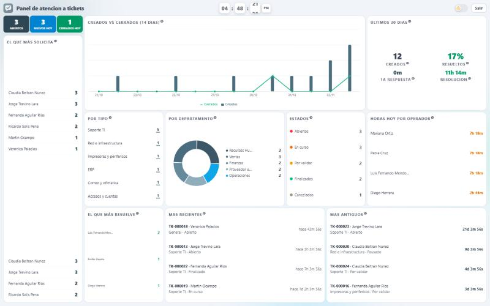

<sub>Support area monitor · <a href="#screenshots">more screenshots</a></sub>

</div>

---

## About this repository

This is the public version of a system I built and that runs as an internal support desk.
To publish it, **branding, domains, credentials, catalogs and the user directory** were
replaced with fictitious equivalents; the code, architecture and business rules are
unchanged. It contains no organization's data or secrets.

> The codebase, comments and UI are in **Spanish** — that is the language of the team it
> was built for. This file documents it in English.

---

## What it solves

A support desk where anyone can open a ticket describing their problem, and an operator
from the relevant area handles it through a chat inside the ticket until it is closed. The
distinctive part: **the operator proposes the closure and the requester validates it**
(two-step confirmation), so nobody closes a ticket that was not actually resolved.

The system splits in two halves:

| | Public side (no sign-in) | Operational side (signed in) |
|---|---|---|
| **Who** | Guests, people without an account or unable to sign in | Users, operators and administrators |
| **What they can do** | Open a ticket with captcha, look it up by reference number, reply in the chat | Full lifecycle, attachments, reports, audit trail |

---

## Features

### Public side — no sign-in
- **Guest** ticket intake protected by **reCAPTCHA v2** (optional: with no keys configured, the form still works).
- **Lookup by reference number**: check status and conversation without an account.
- Guests can **reply in the chat** of their own ticket.
- Guests **cannot** upload files (those endpoints sit behind authentication).

### User
- Dashboard with their tickets and current status.
- Ticket intake that auto-fills name, job title and department from the directory.
- **Chat** with the assigned operator, with attachments (images, PDF, video) and a built-in viewer.
- **Validate** the proposed closure, or **reopen** the ticket if it was not resolved.
- In-app **notification bell** plus email.
- Persistent light / dark theme.

### Operator
- Queue of every ticket, with filters.
- Chat with the requester plus **internal notes** (staff-only).
- Status changes with **mandatory justification** on cancellation.
- Personal **canned responses**, inserted into the chat with one click.
- Editing of requester details and **RustDesk ID** for remote assistance.
- Full-screen **wall monitor** with live team workload.
- Personal stats and a customizable profile (accent color and background image).

### Administrator
- Everything above, plus:
- **Reassigning** the responsible operator.
- **Role management** per user (admin / operator / user).
- **Reports**: which areas request the most, longest-running ticket, handling times measured in business hours.
- **Global audit trail** (`ticket_logs`) of every action in the system, with IP and actor.

---

## Notable business rules

**Ticket lifecycle.** Staff can only move through allowed transitions; the final stretch
belongs to the requester:

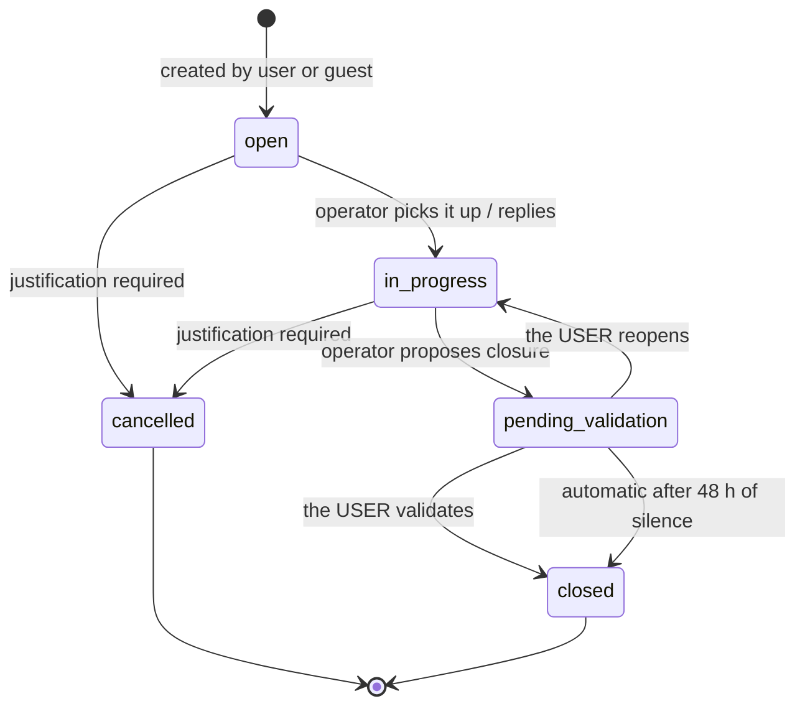

Internally these states are `abierto`, `en_curso`, `cancelado`, `finalizado` and
`validado`. Note the deliberate mismatch: internal `finalizado` is shown in the UI as
**"Por validar"** (pending validation) and `validado` is shown as **"Finalizado"**
(closed). Visible labels speak the user's language; internal ones speak the state
machine's.

**Automatic assignment.** Every ticket category (`ticket_tipos`) has a default responsible
operator, so a new ticket assigns itself. Administrators reassign when needed.

**Automatic closure.** A ticket sitting 48 h in "pending validation" with no reply from the
requester validates itself through the scheduler (`tickets:auto-validar`), recorded in the
timeline with "Sistema" as the actor.

**Business-hours metrics.** Handling times are not measured in wall-clock hours but in
actual working time: Monday to Friday, 8:00–18:30 with a 13:30–15:00 lunch break (9
business hours per day), in the `America/Mexico_City` zone. Timestamps are stored in UTC
and clipped against those windows (`app/Support/CuentaHorarioHabil.php`).

**Payroll number as the relational key.** The user identifier across the whole system is
the **payroll number** (`nomina`), not `users.id`. It can be **negative** — interns and
special accounts — so every column and Sanctum's `tokenable_id` are **signed** integers: a
small detail that breaks authentication for those accounts if overlooked.

---

## Architecture

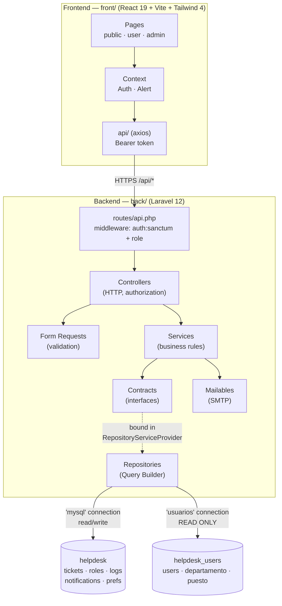

**Layered backend.** `Contracts → Repositories → Services → Controllers → Form Requests`.
Interfaces are bound in `app/Providers/RepositoryServiceProvider.php`, so services depend
on abstractions rather than implementations. Eloquent is used only for `User` and
`PersonalAccessToken`; everything else goes through the Query Builder.

**Two databases, one MySQL instance.** The project owns `helpdesk` (tickets, roles,
logs…) and consumes `helpdesk_users` **read-only**: in the original deployment that user
directory is owned by another system and this project must not touch its schema. Both must
live on the same MySQL server because several reports JOIN across them; the
`app/Support/UsesExternalUsersDb.php` trait resolves the database name from configuration
instead of hardcoding it in every query.

**Authentication.** Sanctum with **Bearer tokens** (no cookies, no CSRF): the SPA stores
the token and sends it with every request. Login validates email + password against the
directory; the **role** lives in the project's own database (`ticket_user_roles`), and a
payroll number with no row there is treated as `usuario`. Role authorization is enforced by
the `role:admin,operador` middleware.

**Schema from SQL scripts, not migrations.** Inherited from the original deployment: the
user directory is shared and must not fall under this project's `artisan migrate`. The
project's own tables are created by the idempotent scripts in [`sql/`](sql/).

---

## Stack

| Layer | Technology |
|---|---|
| API | Laravel 12, PHP 8.2+, Sanctum 4 (Bearer tokens) |
| SPA | React 19, React Router 7, Vite 8, Tailwind CSS 4, framer-motion, Recharts |
| Data | MySQL 8 / MariaDB — two connections (own + read-only directory) |
| Mail | Symfony Mailer (SMTP) with `ShouldQueue` Mailables and Blade views |
| Extras | Installable PWA (`vite-plugin-pwa`, service worker), reCAPTCHA v2, Laravel scheduler |

---

## Layout

```
.
├── back/                  # Laravel 12 API
│   ├── app/
│   │   ├── Contracts/     # Repository interfaces
│   │   ├── Repositories/  # Data access (Query Builder)
│   │   ├── Services/      # Business rules (TicketService, AuthService, ...)
│   │   ├── Http/          # Controllers, Form Requests, role middleware
│   │   ├── Mail/          # Email notifications
│   │   ├── Support/       # Business hours, cross-database JOINs
│   │   └── Console/       # tickets:auto-validar (scheduler)
│   ├── config/            # database.php defines the 'mysql' and 'usuarios' connections
│   └── routes/api.php     # The whole API
├── front/                 # React 19 SPA
│   └── src/
│       ├── api/           # axios client per domain
│       ├── components/    # UI, forms, branding
│       ├── context/       # AuthContext, AlertContext
│       ├── layouts/       # Role-based shell
│       └── pages/         # public / user / admin
├── sql/                   # Schema and demo data, numbered in execution order
└── docs/screenshots/      # Screenshots for this README
```

---

## Setup

### Requirements
PHP 8.2+ · Composer · Node 20+ · MySQL 8 or MariaDB

### 1. Clone

```bash
git clone https://github.com/ghuizar/helpdesk.git
```

### 2. Database

Run the scripts in `sql/` **in numeric order** against your MySQL server. The first one
creates the user-directory database with fictitious data; the rest create the project's own
database and its seed:

```bash
for f in sql/*.sql; do mysql -u root -p < "$f"; done
```

On Windows (PowerShell):

```powershell
Get-ChildItem sql\*.sql | Sort-Object Name | ForEach-Object { mysql -u root -p -e "source $($_.FullName)" }
```

> Both databases (`helpdesk` and `helpdesk_users`) must end up on the **same** MySQL
> instance: several reports JOIN across them.

### 3. Backend

```bash
cd back
composer install
cp .env.example .env
php artisan key:generate
```

Set your MySQL credentials (`DB_USERNAME` / `DB_PASSWORD`) in `.env`, then run:

```bash
php artisan serve
```

> **Windows + OneDrive:** if `key:generate` fails with "bootstrap/cache must be present and
> writable", that is the read-only attribute OneDrive puts on folders. Clear it with
> `attrib -R bootstrap\cache /D` and `attrib -R storage /S /D`.

> **Do not run `php artisan migrate`.** This project's schema comes from the `sql/`
> scripts; the migrations left in `database/migrations/` are Laravel's template ones and
> the application does not use them.

### 4. Frontend

```bash
cd front
npm install
cp .env.example .env
npm run dev
```

The SPA runs at `http://localhost:5173` and talks to the API at `http://127.0.0.1:8000/api`.

### 5. Automatic closure (optional)

For tickets pending validation to close themselves after 48 h, Laravel's scheduler needs a
cron entry:

```bash
* * * * * cd /path/to/project/back && php artisan schedule:run >> /dev/null 2>&1
```

Or run it by hand to try it out:

```bash
php artisan tickets:auto-validar --horas=48
```

---

## Demo accounts

Created by `sql/00_directorio_usuarios_demo.sql`. **Password for all of them: `demo1234`**

| Email | Role | Payroll no. | Notes |
|---|---|---|---|
| `admin@example.com` | Administrator | 1001 | Full access: reports, roles, audit trail |
| `sandra.vargas@example.com` | Administrator | 3001 | Second admin |
| `operador@example.com` | Operator | 1002 | Queue, chat, internal notes, monitor |
| `mariana.ortiz@example.com` | Operator | 1003 | Owns Access and Web portal categories |
| `emilio.zapata@example.com` | Operator | -55 | **Negative payroll number** (special account) |
| `usuario@example.com` | User | 2001 | Opens tickets, validates / reopens |
| `hector.lozano@example.com` | — | 2005 | `status = 0`: use it to test the inactive-account block |

### Sample tickets

`sql/11_datos_demo_tickets.sql` seeds twelve fictional tickets covering all six states,
with chat, internal notes, timeline, audit trail, unread notifications and quick replies.
Without it the app starts empty and the operator panel, the monitor and the reports have
nothing to show.

Dates are relative to "now", so the today / week / month counters always have something in
them. The script is idempotent: it keeps its own ledger (`ticket_demo_seed`) and on a
re-run deletes exactly what it seeded, leaving real tickets untouched.

Sign in as `operador@example.com` to see a queue with data: two unclaimed tickets, one in
progress, one awaiting validation, two resolved (one of them today) and unread items in the
notification bell.

### Entering without an account

The public side needs no account. The login screen has an **Entrar sin cuenta** button that
goes to `/invitado`, where anyone can open a ticket and follow it with its folio. Attaching
evidence and seeing your history do require a session.

---

## Deployment

The backend also serves the frontend, so everything lives on one domain and there is no
CORS to negotiate in production:

1. Run `npm run build` in `front/` and copy the contents of `front/dist/` into `back/public/`.
2. Point the web server's document root at `back/public/`.
3. `Route::fallback(SpaController::class)` serves `index.html` for client-side routes and
   returns JSON 404 for `/api/*`, so the SPA and the API coexist without stepping on each other.
4. In production, restrict `allowed_origins` in `back/config/cors.php` to the real domain
   and set `APP_DEBUG=false`.

> **Before going public:** the API has no rate limiting on any route (`bootstrap/app.php`
> never calls `throttleApi()`). If you expose it to the internet, add at least
> `throttle:5,1` on `api/login`.

---

## Technical decisions worth a look

- **`app/Models/PersonalAccessToken.php`** — Sanctum was inserting tokens into the `User`
  model's connection (the read-only external directory). This model anchors them to the
  project's database, where `tokenable_id` also accepts negative payroll numbers.
- **`app/Support/CuentaHorarioHabil.php`** — converts UTC to local time and clips intervals
  against the working-day windows, so "4 hours of handling time" means four hours of work
  rather than four hours of clock time spanning a weekend.
- **`routes/web.php`** — the SPA fallback is a controller rather than a closure, because
  `route:cache` cannot serialize closures; and a catch-all with a negative lookahead was
  swallowing `GET /api/*` requests and answering them with HTML.
- **`app/Services/TicketService.php`** — one single place holding the valid transitions,
  the mandatory justification, the notifications and the audit trail, so no controller can
  bypass a rule.

---

## Screenshots

All of them come from the seed in `sql/11_datos_demo_tickets.sql`, so this is exactly what
you get once the setup is done.

### Monitor

Wall display for the support area: refreshes on its own and carries no menu.


### Operations side

<table>
<tr>
<td width="50%">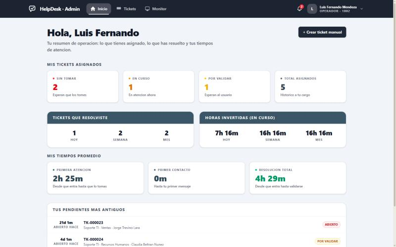Operator panel</b>"><br><sub><b>Operator panel</b> — their assigned load, what they resolved and their own handling times.</sub></td>
<td width="50%">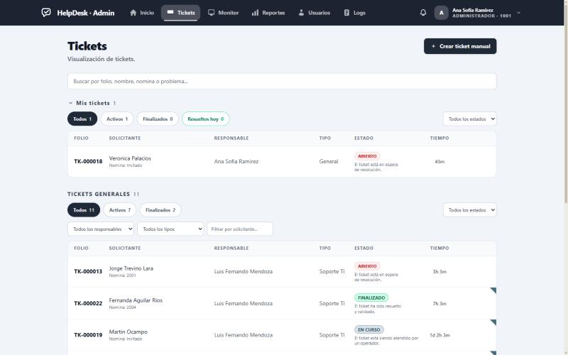Queue</b>"><br><sub><b>Queue</b> — splits own tickets from general ones, with filters by state, owner and category.</sub></td>
</tr>
<tr>
<td width="50%">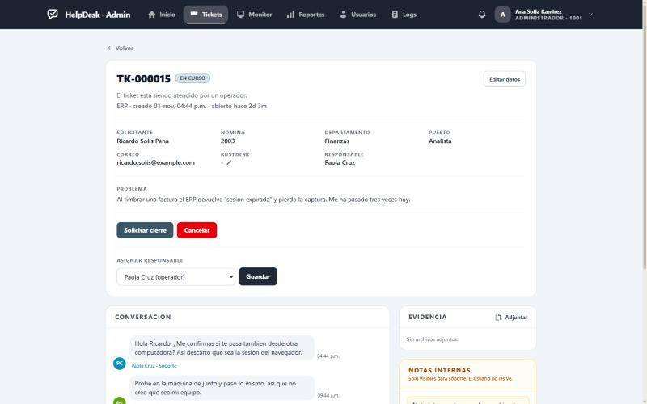Ticket detail</b>"><br><sub><b>Ticket detail</b> — requester data, state actions and owner reassignment.</sub></td>
<td width="50%">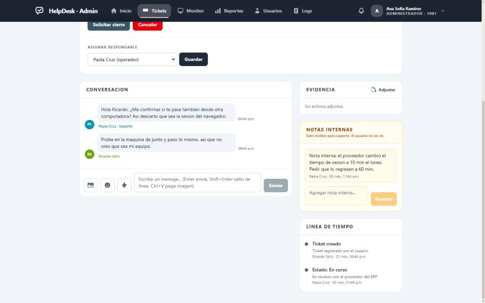Conversation</b>"><br><sub><b>Conversation</b> — ticket chat, internal notes the user never sees, and timeline.</sub></td>
</tr>
<tr>
<td width="50%">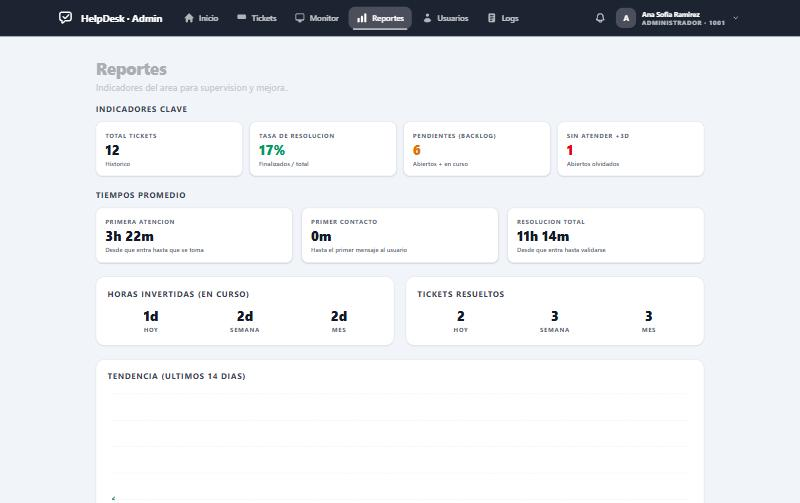Reports</b>"><br><sub><b>Reports</b> — key indicators and average times computed over business hours.</sub></td>
<td width="50%">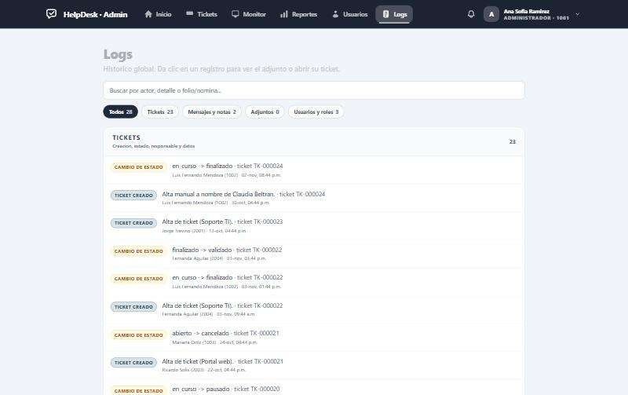Global audit trail</b>"><br><sub><b>Global audit trail</b> — every action is recorded, grouped by kind and filterable.</sub></td>
</tr>
<tr>
<td width="50%">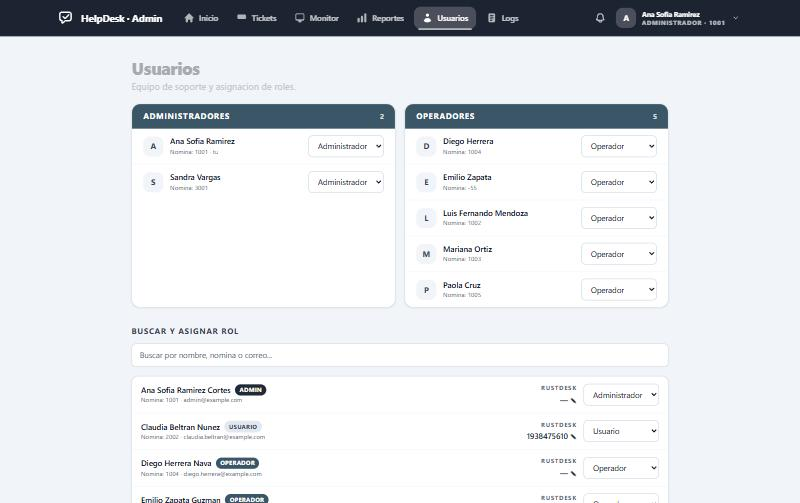Users and roles</b>"><br><sub><b>Users and roles</b> — support team and permission assignment.</sub></td>
<td width="50%"></td>
</tr>
</table>

### Dark mode

Staff turn it on from their profile and users from the menu under their name; the monitor
has its own switch. The preference is stored per person, so everyone sees the system the
way they want it.

<table>
<tr>
<td width="50%">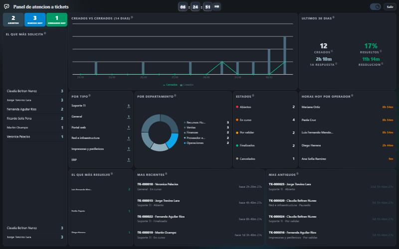<br><sub><b>Monitor in dark</b> — meant to be left running on a screen in the support area.</sub></td>
<td width="50%">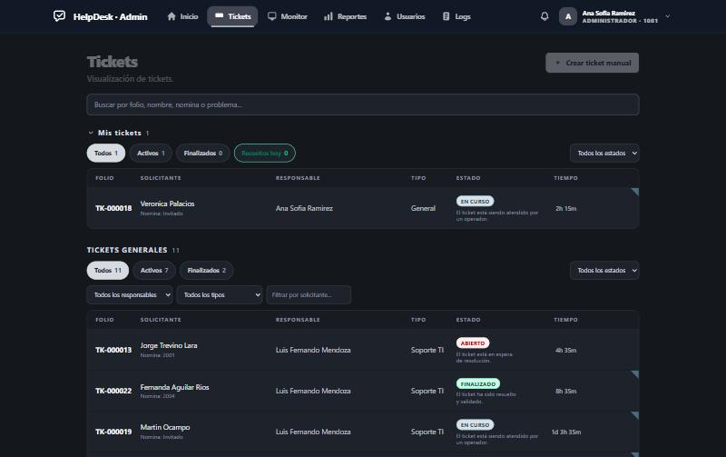<br><sub><b>Queue in dark</b> — state colours stay legible on a dark surface.</sub></td>
</tr>
<tr>
<td width="50%">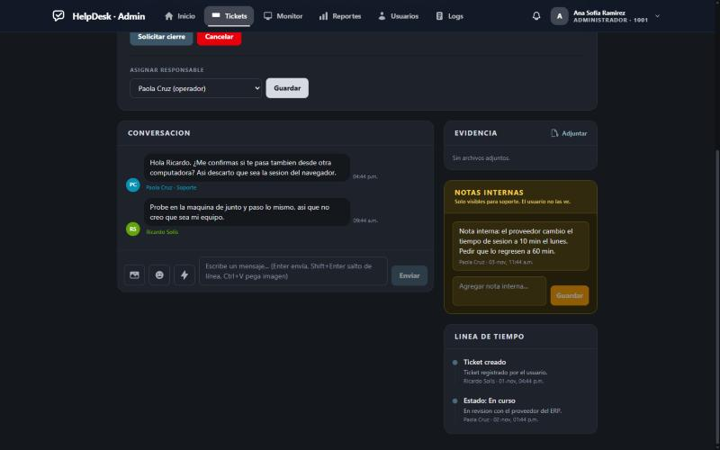<br><sub><b>Conversation in dark</b> — internal notes keep their amber, darkened rather than greyed out.</sub></td>
<td width="50%">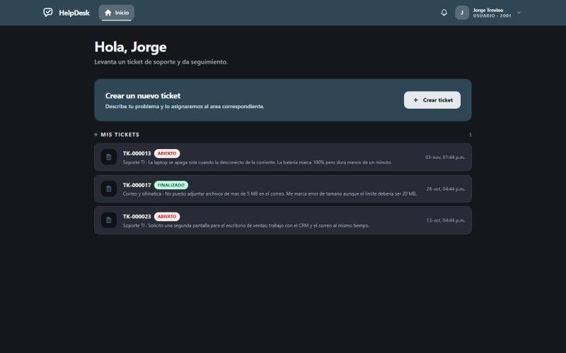<br><sub><b>User panel in dark</b> — the light view supports it too.</sub></td>
</tr>
</table>

### User side and public access

<table>
<tr>
<td width="50%">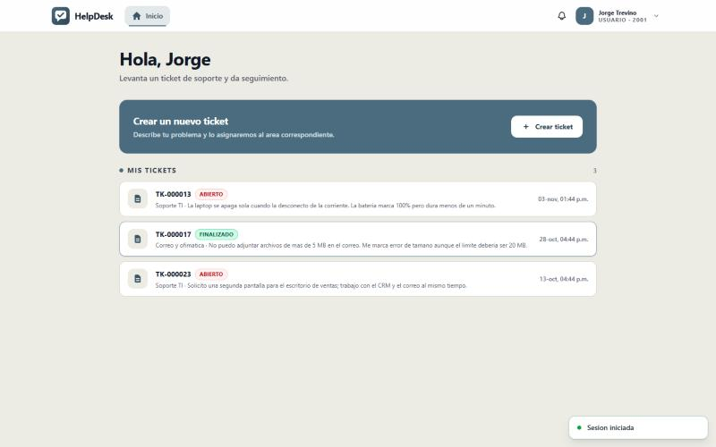User panel</b>"><br><sub><b>User panel</b> — their tickets and the state of each one, in the light warm palette.</sub></td>
<td width="50%">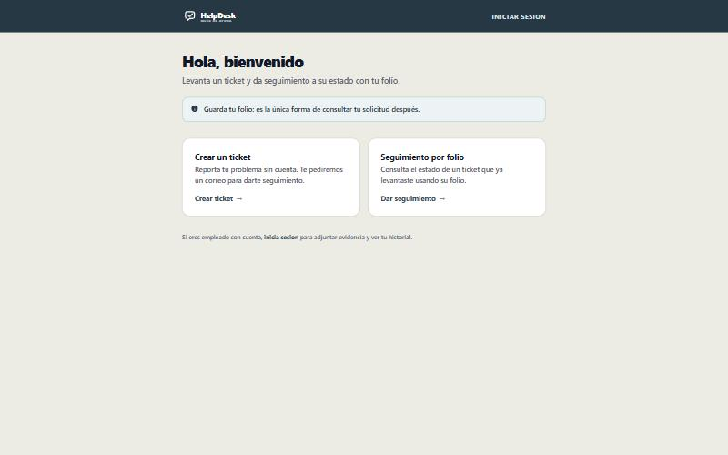Guest portal</b>"><br><sub><b>Guest portal</b> — open a ticket and follow it by folio, with no account.</sub></td>
</tr>
<tr>
<td width="50%">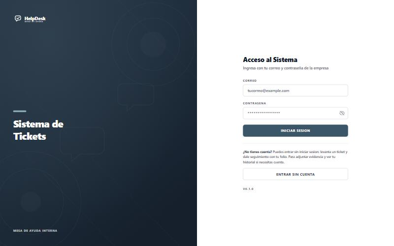Sign in</b>"><br><sub><b>Sign in</b> — company email and password, or enter without an account into the public portal.</sub></td>
<td width="50%"></td>
</tr>
</table>

---

## License

[MIT](LICENSE) © Gael Huizar
