<div align="center">


# HelpDesk — Mesa de Ayuda

**Sistema de tickets de soporte interno.** Laravel 12 (API) + React 19 (SPA) + MySQL.

Alta de tickets con y sin sesión · chat por ticket con notas internas · asignación
automática por tipo · cierre con doble confirmación · métricas en horario hábil ·
bitácora completa · PWA instalable.

[](https://github.com/ghuizar/helpdesk/actions/workflows/ci.yml)
[](https://laravel.com)
[](https://php.net)
[](https://react.dev)
[](https://vite.dev)
[](https://tailwindcss.com)
[](https://mysql.com)
[](LICENSE)

**Español** · [English](README.en.md)

<br>

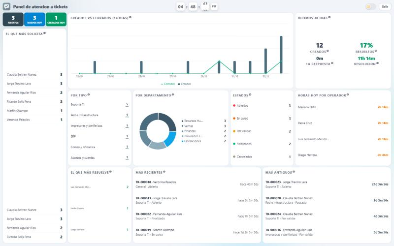

<sub>Monitor del área de soporte · <a href="#capturas">más capturas</a></sub>

</div>

---

## Sobre este repositorio

Versión pública de un sistema que desarrollé y que opera como mesa de ayuda interna.
Para publicarlo se reemplazaron **marca, dominios, credenciales, catálogos y directorio
de usuarios** por equivalentes ficticios; el código, la arquitectura y las reglas de
negocio son los mismos. No contiene datos ni secretos de ninguna organización.

---

## ¿Qué resuelve?

Una mesa de ayuda donde cualquier persona levanta un ticket describiendo su problema y un
operador del área correspondiente lo atiende mediante un chat dentro del ticket, hasta
cerrarlo. La particularidad: **el cierre lo propone el operador y lo valida el usuario**
(doble confirmación), de modo que nadie cierra un ticket que en realidad no quedó resuelto.

El sistema está dividido en dos mitades:

| | Parte pública (sin sesión) | Parte operativa (con sesión) |
|---|---|---|
| **Quién** | Invitados, gente sin cuenta o sin acceso | Usuarios, operadores y administradores |
| **Qué puede hacer** | Levantar ticket con captcha, consultar por folio, responder el chat | Todo el ciclo de vida, adjuntos, reportes, bitácora |

---

## Características

### Parte pública — sin iniciar sesión
- Alta de ticket como **invitado**, protegida con **reCAPTCHA v2** (opcional: sin llaves configuradas el formulario sigue funcionando).
- **Seguimiento por folio**: consulta del estado y de la conversación sin cuenta.
- El invitado puede **responder en el chat** de su propio ticket.
- Los invitados **no** pueden adjuntar archivos (esos endpoints viven detrás de autenticación).

### Usuario
- Dashboard con sus tickets y su estado.
- Alta de ticket con autollenado de nombre, puesto y departamento desde el directorio.
- **Chat** con el operador asignado, con adjuntos (imágenes, PDF, video) y visor integrado.
- **Validar** el cierre propuesto o **reabrir** el ticket si no quedó resuelto.
- Campana de **notificaciones in-app** + correo.
- Tema claro / oscuro persistente.

### Operador
- Bandeja de todos los tickets, con filtros.
- Chat con el solicitante y **notas internas** (visibles solo para staff).
- Cambios de estado con **justificación obligatoria** al cancelar.
- **Respuestas rápidas** propias, insertables en el chat con un clic.
- Edición de los datos del solicitante e **ID de RustDesk** para asistencia remota.
- **Monitor** en pantalla completa (vista de pared) con la carga del equipo en vivo.
- Estadísticas personales y perfil personalizable (color de acento e imagen de fondo).

### Administrador
- Todo lo anterior, más:
- **Reasignación** de responsable.
- **Gestión de roles** por usuario (admin / operador / usuario).
- **Reportes**: áreas que más solicitan, ticket más longevo, tiempos de atención medidos en horario hábil.
- **Bitácora global** (`ticket_logs`) de todas las acciones del sistema, con IP y actor.

---

## Reglas de negocio destacadas

**Ciclo de vida del ticket.** El staff sólo puede avanzar por transiciones permitidas; el
tramo final lo decide el usuario:

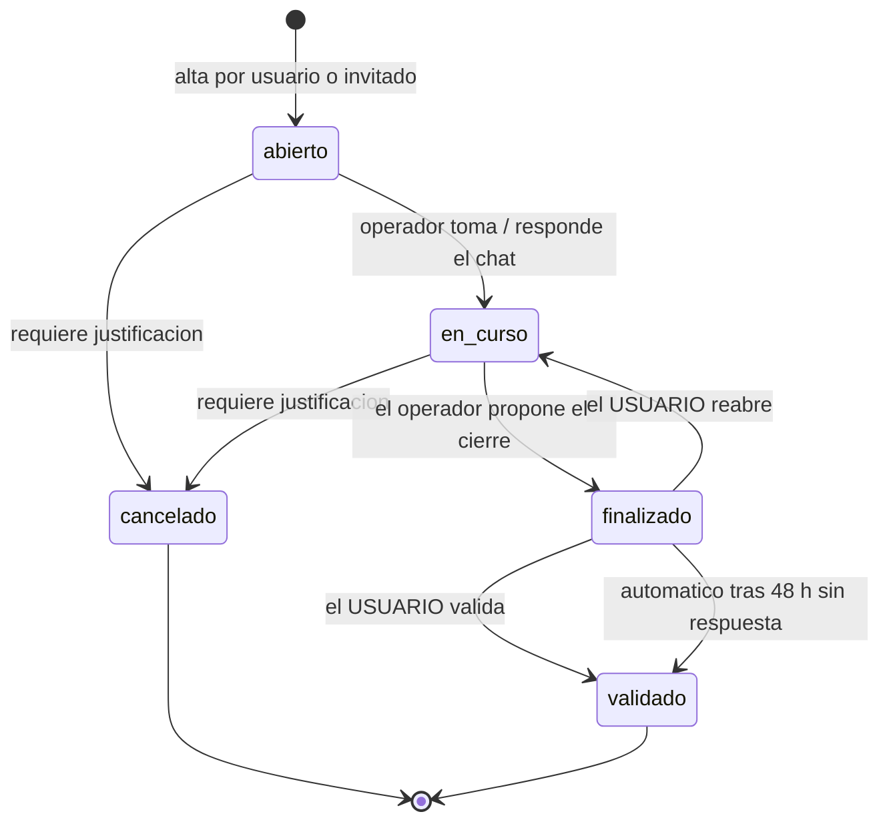

> **Nota de nomenclatura:** el estado interno `finalizado` se muestra en la interfaz como
> **«Por validar»**, y `validado` se muestra como **«Finalizado»**. Los nombres visibles
> hablan el idioma del usuario; los internos, el de la máquina de estados.

**Asignación automática.** Cada tipo de ticket (`ticket_tipos`) tiene un operador
responsable por defecto; al crearse, el ticket se asigna solo. El administrador reasigna
cuando hace falta.

**Cierre automático.** Un ticket que lleva 48 h en «Por validar» sin que el usuario
responda se valida solo, vía scheduler (`tickets:auto-validar`), dejando registro en el
timeline como actor «Sistema».

**Métricas en horario hábil.** Los tiempos de atención no se miden en horas naturales,
sino en jornada real: lunes a viernes, 8:00–18:30 con comida de 13:30 a 15:00 (9 h
hábiles/día), en zona `America/Mexico_City`. Los timestamps se guardan en UTC y se
recortan contra esas ventanas (`app/Support/CuentaHorarioHabil.php`).

**La nómina como clave relacional.** El identificador de usuario en todo el sistema es el
**número de nómina**, no `users.id`. Puede ser **negativo** (becarios y cuentas
especiales), así que todas las columnas y el `tokenable_id` de Sanctum son enteros **con
signo** — un detalle pequeño que, si se ignora, rompe la autenticación de esas cuentas.

---

## Arquitectura

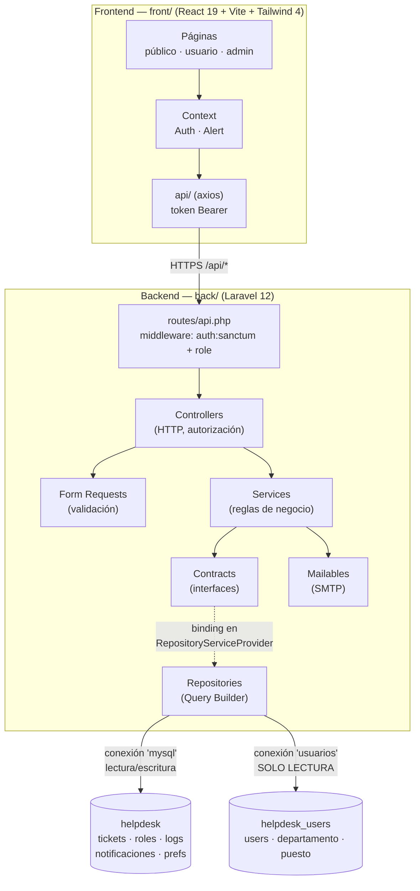

**Backend por capas.** `Contracts → Repositories → Services → Controllers → Form Requests`.
Las interfaces se enlazan en `app/Providers/RepositoryServiceProvider.php`, así que los
servicios dependen de abstracciones y no de implementaciones. Eloquent se usa sólo para
`User` y `PersonalAccessToken`; el resto va con Query Builder directo.

**Dos bases de datos, una sola instancia MySQL.** El proyecto es dueño de `helpdesk`
(tickets, roles, logs…) y consume `helpdesk_users` en **solo lectura**: en el despliegue
original ese directorio de usuarios lo administra otro sistema y este proyecto no debe
tocar su esquema. Ambas deben vivir en el mismo servidor MySQL porque hay JOINs
cross-database; el trait `app/Support/UsesExternalUsersDb.php` resuelve el nombre de la BD
desde la configuración en vez de escribirlo en cada consulta.

**Autenticación.** Sanctum con **tokens Bearer** (no cookies, no CSRF): el SPA guarda el
token y lo reenvía en cada petición. El login valida correo + contraseña contra el
directorio; el **rol** vive en la BD propia (`ticket_user_roles`) y una nómina sin fila ahí
entra como `usuario`. La autorización por rol se aplica con el middleware `role:admin,operador`.

**Esquema por scripts SQL, no por migraciones.** Decisión heredada del despliegue original:
la BD de usuarios es compartida y no debe estar bajo el control de un `artisan migrate` de
este proyecto. Las tablas propias se crean con los scripts idempotentes de [`sql/`](sql/).

---

## Stack

| Capa | Tecnología |
|---|---|
| API | Laravel 12, PHP 8.2+, Sanctum 4 (tokens Bearer) |
| SPA | React 19, React Router 7, Vite 8, Tailwind CSS 4, framer-motion, Recharts |
| Datos | MySQL 8 / MariaDB — dos conexiones (propia + directorio en solo lectura) |
| Correo | Symfony Mailer (SMTP) con Mailables `ShouldQueue` y vistas Blade |
| Extras | PWA instalable (`vite-plugin-pwa`, service worker), reCAPTCHA v2, scheduler de Laravel |

---

## Estructura

```
.
├── back/                  # API Laravel 12
│   ├── app/
│   │   ├── Contracts/     # Interfaces de los repositorios
│   │   ├── Repositories/  # Acceso a datos (Query Builder)
│   │   ├── Services/      # Reglas de negocio (TicketService, AuthService, ...)
│   │   ├── Http/          # Controllers, Form Requests, middleware de rol
│   │   ├── Mail/          # Notificaciones por correo
│   │   ├── Support/       # Horario hábil, JOINs cross-database
│   │   └── Console/       # tickets:auto-validar (scheduler)
│   ├── config/            # database.php define las conexiones 'mysql' y 'usuarios'
│   └── routes/api.php     # Toda la API
├── front/                 # SPA React 19
│   └── src/
│       ├── api/           # Cliente axios por dominio
│       ├── components/    # UI, formularios, marca
│       ├── context/       # AuthContext, AlertContext
│       ├── layouts/       # Shell según rol
│       └── pages/         # público / usuario / admin
├── sql/                   # Esquema y datos demo, numerados por orden de ejecución
└── docs/screenshots/      # Capturas para este README
```

---

## Instalación

### Requisitos
PHP 8.2+ · Composer · Node 20+ · MySQL 8 o MariaDB

### 1. Clonar

```bash
git clone https://github.com/ghuizar/helpdesk.git
```

### 2. Base de datos

Ejecuta los scripts de `sql/` **en orden numérico** sobre tu servidor MySQL. El primero
crea la BD del directorio de usuarios con datos ficticios; el resto crea la BD propia del
proyecto y su semilla:

```bash
for f in sql/*.sql; do mysql -u root -p < "$f"; done
```

En Windows (PowerShell):

```powershell
Get-ChildItem sql\*.sql | Sort-Object Name | ForEach-Object { mysql -u root -p -e "source $($_.FullName)" }
```

> Ambas bases (`helpdesk` y `helpdesk_users`) deben quedar en la **misma instancia** de
> MySQL: varios reportes hacen JOINs entre ellas.

### 3. Backend

```bash
cd back
composer install
cp .env.example .env
php artisan key:generate
```

Ajusta en `.env` las credenciales de MySQL (`DB_USERNAME` / `DB_PASSWORD`) y levanta:

```bash
php artisan serve
```

> **Windows + OneDrive:** si `key:generate` falla con «bootstrap/cache must be present and
> writable», es el atributo de solo lectura que OneDrive pone en las carpetas. Se quita con
> `attrib -R bootstrap\cache /D` y `attrib -R storage /S /D`.

> **No ejecutes `php artisan migrate`.** El esquema de este proyecto se crea con los
> scripts de `sql/`; las migraciones que quedan en `database/migrations/` son las de la
> plantilla de Laravel y no las usa la aplicación.

### 4. Frontend

```bash
cd front
npm install
cp .env.example .env
npm run dev
```

La SPA queda en `http://localhost:5173` y apunta al API en `http://127.0.0.1:8000/api`.

### 5. Cierre automático (opcional)

Para que los tickets en «Por validar» se cierren solos a las 48 h, el scheduler de Laravel
necesita un cron:

```bash
* * * * * cd /ruta/al/proyecto/back && php artisan schedule:run >> /dev/null 2>&1
```

O ejecútalo a mano cuando quieras probarlo:

```bash
php artisan tickets:auto-validar --horas=48
```

---

## Cuentas demo

Las crea `sql/00_directorio_usuarios_demo.sql`. **Contraseña de todas: `demo1234`**

| Correo | Rol | Nómina | Notas |
|---|---|---|---|
| `admin@example.com` | Administrador | 1001 | Acceso total: reportes, roles, bitácora |
| `sandra.vargas@example.com` | Administrador | 3001 | Segundo admin |
| `operador@example.com` | Operador | 1002 | Bandeja, chat, notas internas, monitor |
| `mariana.ortiz@example.com` | Operador | 1003 | Responsable de Accesos y Portal web |
| `emilio.zapata@example.com` | Operador | -55 | **Nómina negativa** (cuenta especial) |
| `usuario@example.com` | Usuario | 2001 | Alta de tickets, validar / reabrir |
| `hector.lozano@example.com` | — | 2005 | `status = 0`: sirve para probar el bloqueo por cuenta inactiva |

### Tickets de ejemplo

`sql/11_datos_demo_tickets.sql` siembra doce tickets ficticios que cubren los seis
estados, con chat, notas internas, línea de tiempo, bitácora, notificaciones sin leer y
respuestas rápidas. Sin él la aplicación arranca vacía y el panel del operador, el monitor
y los reportes no tienen nada que mostrar.

Las fechas son relativas a «ahora», así que los contadores de hoy / semana / mes siempre
traen algo. El script es idempotente: lleva su propio registro (`ticket_demo_seed`) y al
re-ejecutarlo borra exactamente lo que sembró, sin tocar los tickets reales.

Entra con `operador@example.com` para ver la bandeja con datos: dos tickets sin tomar, uno
en curso, uno por validar, dos resueltos (uno de hoy) y avisos sin leer en la campanita.

### Entrar sin cuenta

La parte pública no requiere cuenta. Desde la pantalla de login hay un botón **Entrar sin
cuenta** que lleva a `/invitado`: ahí se puede levantar un ticket y seguirlo con su folio.
Adjuntar evidencia y ver el historial sí requieren sesión.

---

## Despliegue

El backend sirve también al frontend, de modo que todo vive en un solo dominio y no hay
CORS que negociar en producción:

1. `npm run build` en `front/` y copia el contenido de `front/dist/` a `back/public/`.
2. Apunta el document root del servidor web a `back/public/`.
3. `Route::fallback(SpaController::class)` sirve `index.html` para las rutas del cliente y
   devuelve 404 JSON para `/api/*`, así que el SPA y el API conviven sin pisarse.
4. En producción, restringe `allowed_origins` en `back/config/cors.php` al dominio real y
   deja `APP_DEBUG=false`.

> **Pendiente antes de publicar:** el API no tiene *rate limiting* en ninguna ruta
> (`bootstrap/app.php` no llama a `throttleApi()`). Si lo expones a internet, conviene
> añadir al menos `throttle:5,1` en `api/login`.

---

## Decisiones técnicas que vale la pena mirar

- **`app/Models/PersonalAccessToken.php`** — Sanctum insertaba los tokens en la conexión
  del modelo `User` (el directorio externo, de solo lectura). El modelo propio los ancla a
  la BD del proyecto, donde `tokenable_id` además admite nóminas negativas.
- **`app/Support/CuentaHorarioHabil.php`** — convierte UTC a hora local y recorta los
  intervalos contra las ventanas de jornada, para que «4 horas de atención» signifique
  cuatro horas de trabajo y no cuatro horas de reloj sobre un fin de semana.
- **`routes/web.php`** — el fallback del SPA es un controlador y no un closure, porque
  `route:cache` no puede serializar closures; y un catch-all con lookahead negativo se
  comía los `GET /api/*` devolviéndoles HTML.
- **`app/Services/TicketService.php`** — un solo punto donde viven las transiciones
  válidas, la justificación obligatoria, las notificaciones y la bitácora, de modo que
  ningún controlador pueda saltarse una regla.

---

## Capturas

Todas salen de la semilla de `sql/11_datos_demo_tickets.sql`, así que es lo mismo que vas
a ver tú al terminar la instalación.

### Monitor

Pantalla de pared para el área de soporte: se actualiza sola y no lleva menú.


### Parte operativa

<table>
<tr>
<td width="50%">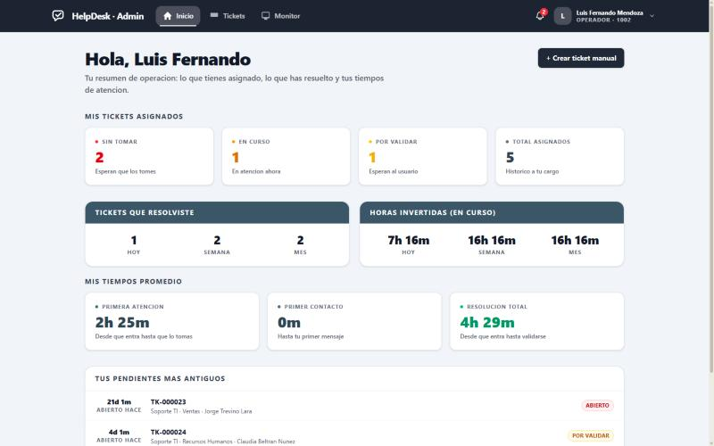Panel del operador</b>"><br><sub><b>Panel del operador</b> — su carga asignada, lo que resolvió y sus tiempos de atención.</sub></td>
<td width="50%">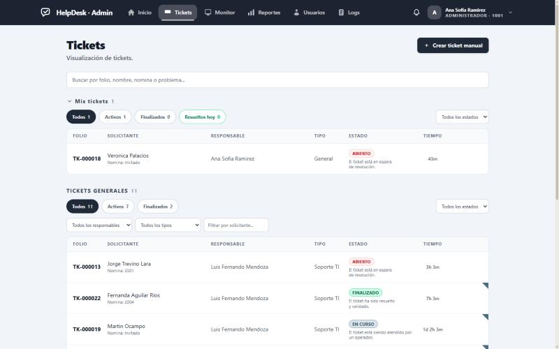Bandeja</b>"><br><sub><b>Bandeja</b> — separa los tickets propios de los generales, con filtros por estado, responsable y tipo.</sub></td>
</tr>
<tr>
<td width="50%">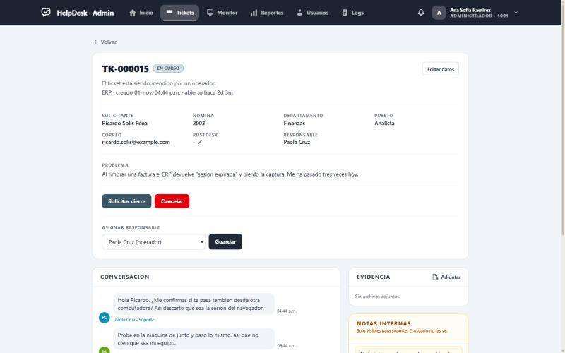Detalle del ticket</b>"><br><sub><b>Detalle del ticket</b> — datos del solicitante, acciones de estado y reasignación de responsable.</sub></td>
<td width="50%">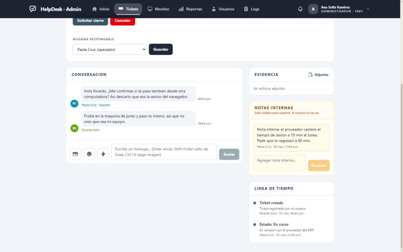Conversación</b>"><br><sub><b>Conversación</b> — chat del ticket, notas internas que el usuario no ve y línea de tiempo.</sub></td>
</tr>
<tr>
<td width="50%">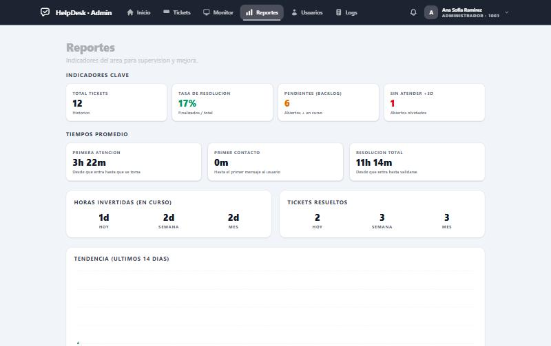Reportes</b>"><br><sub><b>Reportes</b> — indicadores clave y tiempos promedio calculados en horario hábil.</sub></td>
<td width="50%">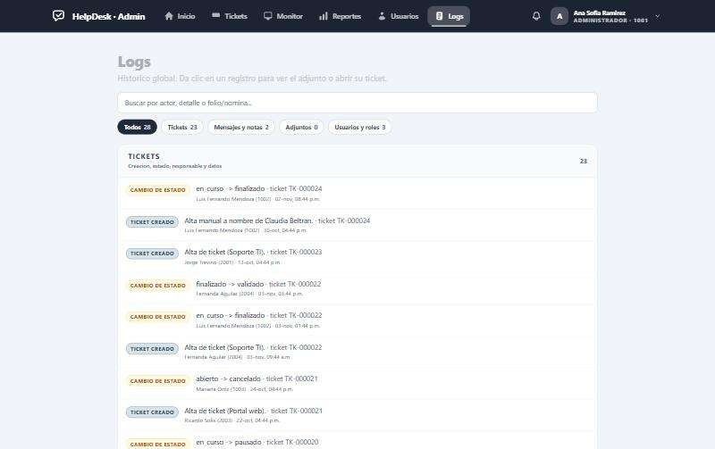Bitácora global</b>"><br><sub><b>Bitácora global</b> — toda acción queda registrada, agrupada por tipo y filtrable.</sub></td>
</tr>
<tr>
<td width="50%">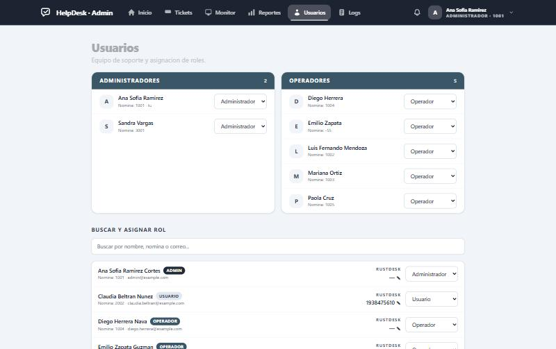Usuarios y roles</b>"><br><sub><b>Usuarios y roles</b> — equipo de soporte y asignación de permisos.</sub></td>
<td width="50%"></td>
</tr>
</table>

### Modo oscuro

El personal lo activa desde su perfil y el usuario desde el menú de su nombre; el monitor
tiene su propio interruptor. La preferencia se guarda por persona, así que cada quien ve el
sistema como quiera.

<table>
<tr>
<td width="50%">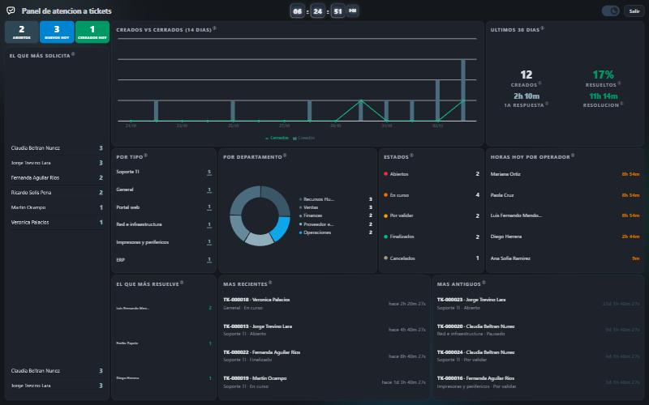<br><sub><b>Monitor en oscuro</b> — pensado para dejarlo encendido en una pantalla del área.</sub></td>
<td width="50%">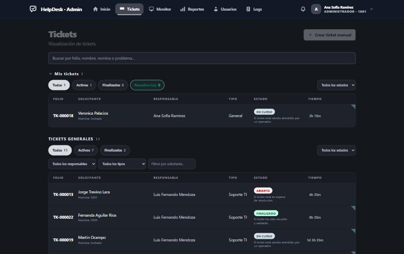<br><sub><b>Bandeja en oscuro</b> — los colores de estado se mantienen legibles sobre fondo oscuro.</sub></td>
</tr>
<tr>
<td width="50%">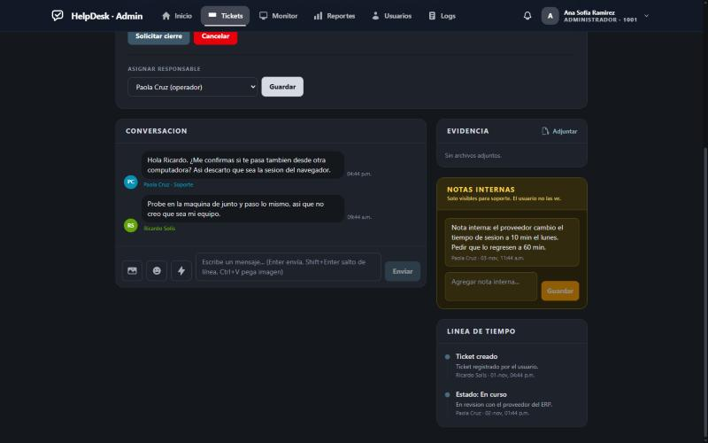<br><sub><b>Conversación en oscuro</b> — las notas internas conservan su ámbar, oscurecido en vez de agrisado.</sub></td>
<td width="50%">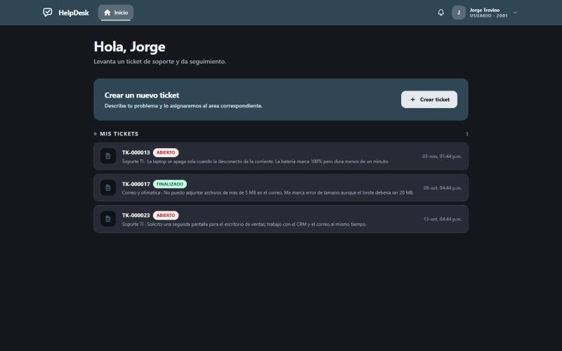<br><sub><b>Panel del usuario en oscuro</b> — la vista clara también lo soporta.</sub></td>
</tr>
</table>

### Parte del usuario y acceso público

<table>
<tr>
<td width="50%">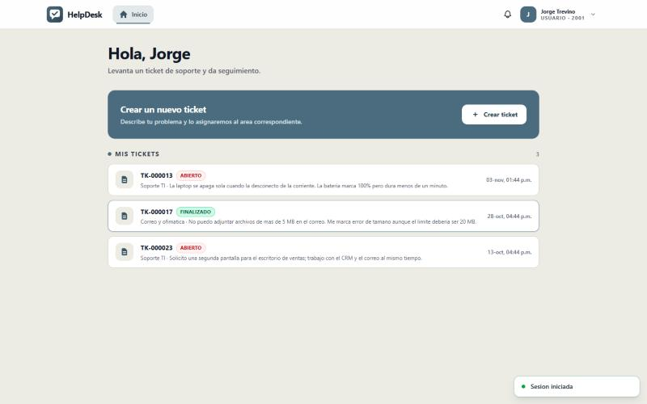Panel del usuario</b>"><br><sub><b>Panel del usuario</b> — sus tickets y el estado de cada uno, en la paleta clara y cálida.</sub></td>
<td width="50%">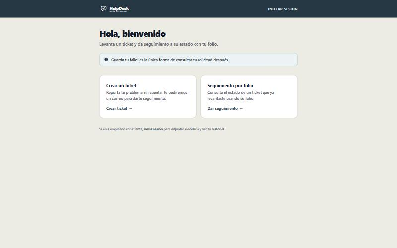Portal de invitado</b>"><br><sub><b>Portal de invitado</b> — levantar un ticket y darle seguimiento por folio, sin cuenta.</sub></td>
</tr>
<tr>
<td width="50%">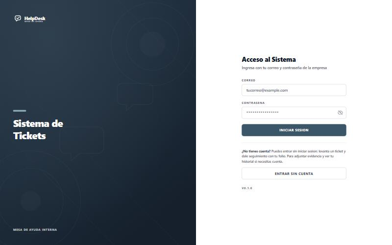Acceso</b>"><br><sub><b>Acceso</b> — correo y contraseña de la empresa, o entrar sin cuenta al portal público.</sub></td>
<td width="50%"></td>
</tr>
</table>

---

## Licencia

[MIT](LICENSE) © Gael Huizar